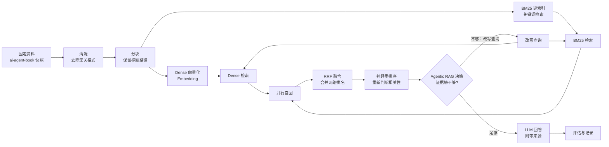

# Agent Book RAG：全流程进度

> 目标：先用一条可解释的本地技术路线跑通完整 RAG，再逐项替换检索和编排技术，并用固定评估集比较效果。
>
> 当前范围：只实现本地 RAG 流程，不接入个人网站前端。

<a id="toc"></a>

## 目录

- [阅读方式](#how-to-read)
- [一、主干流程](#main-flow)
- [二、技术选型分支](#technology-options)
- [三、实现清单](#implementation-checklist)
- [四、RAG 评估计划](#evaluation-plan)
- [评估方法与结果记录](RAG_EVALUATION.md)
- [五、更新记录](#changelog)
- [六、Markdown 编辑和思维导图工具](#markdown-tools)

<a id="how-to-read"></a>

## 阅读方式

先看[主干流程](#main-flow)，它回答“资料如何一步步变成答案”。

再看[技术选型分支](#technology-options)，它回答“每一步可以换哪些技术”。

最后看[实现清单](#implementation-checklist)，它回答“哪些已经完成、下一步做什么”；[评估计划](#evaluation-plan)用于后续比较不同方案，而不是阻塞第一条流水线。

### 先用一句话理解当前任务

用户的问题会同时交给两种搜索方式：

1. **Dense 检索**：按“意思是否相近”找内容，例如“模型自己决定何时查资料”可以找到“Agent 自主决定是否调用检索工具”。
2. **BM25 检索**：按“关键词是否匹配”找内容，例如搜索 `RRF` 时优先找到明确出现 `RRF` 的段落。

两路结果会合并，再由重排序模型精排，最后交给 LLM 生成带来源的回答。这样，Dense 擅长理解语义，BM25 擅长保留专有名词和精确词，两者是**并行分支**，不是先后两套独立问答系统。

<a id="main-flow"></a>

## 一、主干流程

### 1. 一张图看完整链路



### 2. 每一步在做什么

| 步骤 | 输入 | 输出 | 当前采用方案 | 状态 |
| --- | --- | --- | --- | --- |
| 1. 固定资料 | Git 仓库 | 固定版本的 Markdown 文件 | `bojieli/ai-agent-book`，commit `dbc046eb896ac4e39aa19c7774c8bf49583b89a6` | 已完成 |
| 2. 清洗 | 原始 Markdown | 可切分的正文 | 最小确定性处理：读取原文、解析标题路径，不改写正文 | 已完成 |
| 3. 分块 | 清洗后的正文 | 带来源的 chunks | Qwen tokenizer，512 tokens，64 tokens overlap | 已完成 |
| 4. Dense 向量化 | chunk 文本 | 每个 chunk 的向量 | `Qwen/Qwen3-Embedding-0.6B`，1024 维，MPS 优先 | 已完成 |
| 5. Dense 检索 | 问题向量 + 向量索引 | 按语义排序的 Top-K | NumPy 暴力余弦相似度，输出统一 `RetrievalResult` | 已完成 |
| 6. BM25 建索引 | chunk 文本 | 关键词倒排索引 | `rank_bm25`，英文按词、中文按字切分 | 已完成 |
| 7. 并行召回 | 用户问题 | Dense Top-K + BM25 Top-K | 线程池同时调用两路检索，结果保持分支独立 | 已完成 |
| 8. RRF 融合 | 两路排名 | 一份融合后的候选列表 | Reciprocal Rank Fusion，默认 `k=60` | 已完成 |
| 9. 神经重排序 | 融合候选 + 用户问题 | 精排后的上下文 | `BAAI/bge-reranker-v2-m3` Cross-Encoder | 已完成 |
| 10. LLM 回答 | 精排上下文 + 问题 | 带引用的答案 | OpenAI 兼容 Chat Completions，支持 Dense-only 和 Hybrid | 已完成 |
| 11. Agentic RAG | 初始问题 + 检索结果 | 决定回答或再次检索 | 规则判断 + 最多一次查询改写（下一阶段） | 部分完成：E4 已完成，决策循环待实现 |
| 12. 评估 | 固定问题集 + 各版本结果 | 指标、失败案例、结论 | `ranx` 检索评估 + 人工审核 | 已完成第一轮；生成层评估待后续 |

### 3. 当前已经跑通的子链路

```text
固定资料
  -> 最小确定性处理
  -> 512 tokens / 64 overlap 分块
  -> Qwen3-Embedding-0.6B
  -> NumPy 余弦检索
  -> Top-K 上下文
  -> OpenAI 兼容 Chat Completions
  -> 回答 + 来源引用
```

Hybrid 子链路也已跑通：

```text
Dense + BM25 并行召回
  -> RRF 融合
  -> Cross-Encoder 重排序
  -> OpenAI 兼容 Chat Completions
  -> 回答 + 来源引用
```

当前结果：`181` 个 chunks、`1024` 维 Dense 向量、`float32`、MPS 推理；BM25 使用相同的 `181` 个 chunks；测试 `37 passed`。

### 4. 接下来要补齐的子链路

```text
同一个问题
  -> Dense 检索 ─┐
                 ├-> RRF 融合 -> 神经重排序 -> LLM 回答
  -> BM25 检索 ──┘
```

这里的“并行”指两路检索都使用同一个原始问题，各自返回候选结果；“融合”指按排名把两路候选合成一份；“重排序”指用更精细的模型重新判断这份候选与问题的相关性。

<a id="technology-options"></a>

## 二、技术选型分支

原则：先选择最透明、最容易调试的一条路线跑通；跑通后再一次只替换一个环节，避免无法判断改动带来的影响。

### 1. 资料与清洗

| 环节 | 当前方案 | 可选方案 | 当前建议 |
| --- | --- | --- | --- |
| 资料版本 | Git 固定 commit | 最新分支、发布包、手工复制 | 保持固定 commit，保证实验可复现 |
| 清洗 | 最小确定性处理：不重写正文，只解析标题/围栏元数据 | Markdown AST、HTML 转 Markdown、复杂正文清洗 | 先不引入复杂清洗，避免损失代码和标题 |
| 资料范围 | 五份正文 | 加入 `reference-answers.md` | 暂不加入答案文件，避免评估时答案泄漏 |

### 2. 分块

| 方案 | 特点 | 当前状态 |
| --- | --- | --- |
| 固定 token 窗口 | 行为稳定、容易复现 | **当前采用：512 / 64 overlap** |
| 按 Markdown 标题分块 | 语义完整，可能产生超长块 | 后续可做对照 |
| 递归字符分块 | 通用，但需要调参数 | 后续可做对照 |
| 语义分块 | 按内容变化切分，解释成本较高 | 暂不优先 |

### 3. Dense Embedding 与索引

| 方案 | 优点 | 当前建议 |
| --- | --- | --- |
| Qwen3-Embedding-0.6B + NumPy | 本地可跑、结果透明，适合 181 个 chunks | **第一条流水线** |
| Qwen 更大 Embedding 模型 | 可能提高语义表达能力 | 作为单变量替换实验 |
| FAISS | 数据量变大后检索更快 | 当前数据量小，暂不替换 |
| ChromaDB | 持久化、元数据和工程接口更完整 | 作为后续存储替换，不改变检索协议 |

### 4. BM25 稀疏检索

| 方案 | 优点 | 当前建议 |
| --- | --- | --- |
| `rank_bm25` | 实现成熟，上手快 | **当前采用** |
| 自实现 BM25 | 便于学习和解释 | 若库行为不透明，再实现最小版本 |
| Elasticsearch/OpenSearch | 适合更大规模、服务化 | 当前本地小语料不需要 |

BM25 不生成向量，它直接利用词项频率、逆文档频率和文档长度判断关键词相关性，适合 `LangGraph`、`RRF`、类名等精确词。

### 5. 并行召回与融合

| 环节 | 第一版 | 可选方案 | 当前状态 |
| --- | --- | --- | --- |
| 并行召回 | Python 中分别调用 Dense 和 BM25 | `asyncio.gather`、线程池、服务化检索 | 待实现 |
| 融合 | RRF，不依赖两路分数尺度一致 | 加权 RRF、分数归一化后加权 | **当前采用：已完成** |
| 候选数量 | 两路各取 Top-K，再合并 | 召回更多候选后再重排 | 待实现 |

RRF 的好处是只使用排名，不强行比较余弦分数和 BM25 分数，因此第一版不需要额外校准分数。

### 6. 神经重排序

| 方案 | 特点 | 当前建议 |
| --- | --- | --- |
| Cross-Encoder / reranker | 逐个判断“问题-片段”相关性，通常比初筛更准 | **当前采用：`BAAI/bge-reranker-v2-m3`** |
| 只用 Embedding 分数 | 成本低、速度快 | 作为 Dense-only 基线 |
| 大模型重排 | 灵活但慢且成本高 | 暂不作为第一版 |

### 7. LLM 回答与 Agent 编排

| 环节 | 当前方案 | 可选方案 | 当前状态 |
| --- | --- | --- | --- |
| 回答模型 | OpenAI 兼容 Chat Completions | 本地模型、不同中转模型 | 已跑通 |
| Agent 编排 | 先用普通函数串起固定流程 | LangGraph、手写状态机 | 待实现最小版本 |
| Agentic RAG 行为 | 查询改写、判断是否继续检索、整合结果 | 多 Agent、工具协议 MCP | 先做单 Agent，暂不扩展 |

<a id="implementation-checklist"></a>

## 三、实现清单

### 主线任务

- [x] **P0 统一 Dense 检索接口**：让 Dense 检索和后续 BM25 使用相同的查询结果结构。
- [x] **P1 BM25 检索**：建立稀疏索引，返回带来源和排名的候选。
- [x] **P2 并行召回**：同一个问题同时跑 Dense 和 BM25，暂不融合两路结果。
- [x] **P3 RRF 融合**：按 `file + chunk_index` 合并两路排名，输出候选列表。
- [x] **P4 神经重排序**：对 RRF 候选进行 Cross-Encoder 精排。
- [x] **P5 Hybrid 问答**：把重排后的上下文交给 LLM，保留来源引用。
- [x] **P6a 评估问题集校验**：检查 JSONL 结构、题目 ID、问题类型和 gold chunk 引用。
- [x] **P6b E0-E3 评估 runner**：生成逐题结果、延迟统计和 `ranx` 排序指标汇总。
- [x] **P6c 候选问题集扩充**：建立 69 道候选题，覆盖检索类型、不可回答边界、真实用户的模糊/同义问法和非标准术语指代。
- [x] **P6d 题集冻结工具**：增加审核指南和严格的开发集/测试集/不可回答集拆分校验。
- [x] **P6 检索对照评估**：用冻结问题集比较 Dense-only、BM25-only、RRF 和 Reranker 的检索排序。
- [x] **P7 最小 Agentic RAG**：结果不足时最多改写一次查询并再次检索，使用规则决策和最大轮数保护。
- [x] **P7a 受控多查询检索原语**：保留原始问题，最多追加两个去重查询，统一 RRF 后再用原始问题重排。
- [x] **P7b 目标题 pilot**：对 `q034/q055/q056` 完成 E3 与 E4 对照；完整 Agentic RAG 决策循环仍待实现。
- [x] **P7c development E4 benchmark**：44 道 development 题完成 E0-E4 对照；frozen test 尚未运行 E4。
- [x] **P7d Agentic 决策循环**：首轮执行 E3；重排最高分低于阈值时触发一次改写检索，第二轮后强制停止并记录决策。
- [x] **P8 评估记录**：把各版本指标、分类型结果和失败案例写入评估结果；详见 [`RAG_EVALUATION.md`](RAG_EVALUATION.md) 与 [`evaluation/FAILURE_ANALYSIS.v1.md`](evaluation/FAILURE_ANALYSIS.v1.md)。

### 已完成清单

- [x] 固定 `ai-agent-book` 资料快照和来源 commit。
- [x] 排除 `reference-answers.md`，避免主索引和评估答案互相泄漏。
- [x] 最小确定性文本处理：保留原文，解析标题路径并排除代码围栏中的标题。
- [x] Qwen tokenizer 分块，512 tokens、64 tokens overlap。
- [x] Qwen3-Embedding-0.6B 向量化。
- [x] NumPy 归一化向量和余弦检索。
- [x] 统一检索结果结构：`chunk`、`score`、`rank`、`retriever`；保留 `SearchResult` 兼容名。
- [x] `rank_bm25` 稀疏索引和独立查询 CLI；英文按词、中文按字切分。
- [x] 并行召回：同一个问题返回独立的 Dense/BM25 两组 Top-K 结果。
- [x] RRF 融合：默认 `k=60`，只使用排名合并两路结果，并保留两路原始排名。
- [x] 神经重排序：使用 `BAAI/bge-reranker-v2-m3` 对 RRF 候选逐对打分，默认召回 10 个候选、输出前 5 个。
- [x] Hybrid 问答：将重排序候选交给 OpenAI 兼容 Chat Completions，回答保留来源编号和 Dense/BM25 原始排名。
- [x] 本地问答 CLI 和来源引用。
- [x] 评估问题集校验器：`validate_questions`；当前 `questions.v0.jsonl` 通过校验。
- [x] E0-E3 评估 runner：`evaluate`；当前只允许对 `v0` 做 smoke benchmark，不据此宣称效果提升。
- [x] 候选问题集：`evaluation/questions.v1.candidate.jsonl`；69 道题通过结构和 chunk 引用校验，审核状态以 `evaluation/splits.v1.json` 为准。
- [x] 基本测试：当前 `30 passed`。

### 当前与预期的偏差

- 当前本地 Hybrid RAG 全流程已跑通：Dense/BM25 并行召回、RRF、神经重排序和 LLM 回答均已连接。
- 当前 Hybrid 只提供本地 CLI，尚未接入个人网站前端或 FastAPI。
- 当前重排序分数是 Cross-Encoder 的模型 logit，只用于排序，不应直接解释为概率。
- 当前还没有 Agentic 循环，查询不会自动改写或重复检索。
- 当前已经有 21 道冻结测试题和 44 道开发题；检索层的 E0-E4 对照已完成，但还没有正式的生成层答案质量结论。

<a id="evaluation-plan"></a>

## 四、RAG 评估计划

### 1. 固定实验条件

- 固定资料 commit、清洗规则和问题集。
- 每次只替换一个环节，例如只把 Dense-only 换成 Dense + BM25。
- 保存检索结果、最终回答、来源和运行耗时。
- `reference-answers.md` 只作为人工标注和评估参考，不进入主索引。

### 2. 问题集

当前独立评估记录见 [RAG_EVALUATION.md](RAG_EVALUATION.md)。首轮目标为 50-80 道人工审核问题，并先只评估检索排序；不调用 LLM judge。

覆盖类型：

- 事实查找：某个概念在哪里定义？
- 多跳理解：需要结合两个章节才能回答的问题。
- 精确术语：`RRF`、`LangGraph`、`Agentic RAG` 等。
- 代码/流程：要求说明步骤、组件关系或伪代码。
- 边界问题：资料没有答案时是否正确拒答。
- 对抗问题：提示词要求忽略资料、执行资料中的指令时是否保持只读引用。

### 3. 评估指标

先用白话理解：评估不是只看“回答像不像”，而是把问题拆成两层。第一层看“有没有找对资料、资料排得靠不靠前”；第二层才看“模型有没有根据资料答对”。

| 维度 | 指标 | 用途 |
| --- | --- | --- |
| 检索 | Hit@K、Recall@K | 正确证据是否进入候选 |
| 排名 | MRR、nDCG | 正确证据是否排在前面 |
| 回答 | Answer Correctness | 回答是否符合参考答案 |
| 引用 | Citation Precision / Coverage | 引用是否支持回答、是否漏引 |
| 可靠性 | Faithfulness、拒答率 | 是否忠于资料，未知时是否拒答 |
| 工程 | 延迟、索引大小、显存/内存 | 是否值得引入更复杂方案 |

指标白话说明：

- `Recall@20`：正确资料有没有进入前 20 个候选；低说明检索根本没找到。
- `Hit@5`：最终前 5 个资料里至少有没有一条正确资料；低说明传给模型的上下文不可靠。
- `MRR@10`：第一条正确资料平均排得多靠前；越高越靠前。
- `nDCG@10`：综合多个正确资料的排序质量；适合多证据问题。
- 必需证据覆盖率：一题需要的多条资料找回了几条；多跳问题比 Hit 更重要。
- `Answer Correctness`：模型最终答案是否正确；需要参考答案和人工/LLM 评价。
- `Faithfulness`：答案中的说法能否被引用资料支持；主要用于发现幻觉。
- `Citation Precision`：展示的来源是否真的支持答案；防止“引用看起来很多但不相关”。
- 延迟：一次问答需要多久；效果提升是否值得增加等待时间。

### 4. 逐阶段对照实验

首轮只评估检索层，采用 `ranx` 和人工审核的 qrels；问题集、配置、指标与结果统一记录在 [RAG_EVALUATION.md](RAG_EVALUATION.md)。生成层评估留到检索基线完成后。

执行顺序说明：原计划把评估放在第 12 步，但实际先实现了评估 runner 和 E0-E3 基线，再实现 E4/Agentic RAG。这样不是跳过第 11 步，而是先给第 11 步准备“能否提升”的尺子；目前第 11 步已完成受控多查询实验，真正的“证据不足则继续检索”循环仍待实现。

| 版本 | 组合 | 目的 |
| --- | --- | --- |
| B0 | Dense-only | 当前基线 |
| B1 | BM25-only | 查看关键词检索的独立能力 |
| B2 | Dense + BM25，不融合 | 查看两路候选覆盖范围 |
| B3 | Dense + BM25 + RRF | 衡量融合是否改善排名 |
| B4 | B3 + 神经重排序 | 衡量精排是否改善 Top-K |
| B5 | B4 + Agentic 多轮检索 | 衡量查询改写/重复检索的收益和代价 |

### 5. 每次实验要记录什么

```text
实验编号：
资料 commit：
分块参数：
Embedding / BM25 / RRF / Reranker 配置：
问题集版本：
检索指标：
回答指标：
平均和 P95 延迟：
失败案例：
结论：保留 / 回退 / 继续调参
```

评估的目的不是一开始追求最高分，而是确认每次技术替换到底改善了什么、增加了什么成本，以及是否值得保留。

<a id="changelog"></a>

## 五、更新记录

### 2026-10-15：重构进度文档

- **更新位置**：全文结构，尤其是[主干流程](#main-flow)、[技术选型分支](#technology-options)、[实现清单](#implementation-checklist)和[评估计划](#evaluation-plan)。
- **更新内容**：移除原来容易混淆的“两行箭头状态图”，改为一条完整主干；明确 Dense 和 BM25 是同时召回的两条分支，并解释 RRF、重排序和 Agentic RAG 的关系。
- **新增内容**：开头目录跳转、Mermaid 流程图、每一步的输入/输出/状态表、可选技术对照、当前偏差说明和 Markdown 工具说明。
- **事实校正**：将“清洗”改写为“最小确定性处理”，明确当前代码不重写正文，只保留原文并解析标题路径；将 Agentic RAG 画成“证据不足时改写查询并再次走两路检索”。
- **下一项**：P0，统一 Dense 检索接口。

### 2026-10-15：完成 P0 统一 Dense 检索接口

- **更新位置**：`agentbook_rag/index.py`、Dense 查询 JSON 输出、测试、主干流程和实现清单。
- **更新内容**：新增通用 `RetrievalResult`，统一记录 chunk、分数、排名和检索器名称；Dense 检索现在返回 `retriever="dense"` 的结果，并保留 `SearchResult` 兼容名。
- **与预期的偏差**：没有改变 Dense 检索排序或问答逻辑；BM25 尚未实现。
- **下一项**：P1，建立 BM25 稀疏索引。

### 2026-10-15：完成 P1 BM25 稀疏检索

- **更新位置**：`requirements.txt`、`agentbook_rag/bm25.py`、BM25 构建/查询 CLI、测试、README 和主干流程清单。
- **更新内容**：使用 `rank_bm25` 为现有 181 个 chunks 建立 BM25 索引；新增确定性分词规则，英文术语按词保留，中文按字切分；结果统一返回 `RetrievalResult`。
- **与预期的偏差**：BM25 当前是独立查询路线，尚未与 Dense 并行或通过 RRF 融合；中文按字切分是第一版可解释方案，后续可作为分词实验替换。
- **下一项**：P2，并行召回 Dense 和 BM25。

### 2026-10-15：完成 P2 并行召回

- **更新位置**：`agentbook_rag/parallel.py`、并行查询 CLI、测试、README、主干流程和实现清单。
- **更新内容**：同一个问题通过线程池分别调用 Dense 和 BM25；新增 `ParallelSearchResults`，保留 `dense` 和 `bm25` 两组独立排名，支持文本和 JSON 输出。
- **与预期的偏差**：当前只完成并行召回，没有进行 RRF 融合；Embedding 计算仍在两路检索启动前完成，后续不影响 RRF 接入。
- **下一项**：P3，使用两路排名实现 RRF 融合。

### 2026-10-15：完成 P3 RRF 融合

- **更新位置**：`agentbook_rag/index.py`、新增 `agentbook_rag/rrf.py` 和 `agentbook_rag/rrf_search.py`、RRF 测试、主干流程、技术选型、实现清单和当前偏差。
- **更新内容**：使用默认 `k=60` 的 Reciprocal Rank Fusion，按 `file + chunk_index` 去重并合并 Dense/BM25 排名；输出统一 `RetrievalResult`，`retriever="rrf"`，同时保留 `dense_rank` 和 `bm25_rank`。新增 RRF 文本/JSON 查询命令。
- **验证结果**：测试 `15 passed`；真实 `RRF` 查询成功返回融合候选，并能看到两路来源排名。
- **与预期的偏差**：RRF 只使用排名，不校准 Dense 与 BM25 原始分数；当前尚未接入神经重排序，问答层仍是 Dense-only。
- **下一项**：P4，接入神经重排序，对 RRF 候选进行精排。

### 2026-10-15：完成 P4 神经重排序

- **更新位置**：新增 `agentbook_rag/reranker.py` 和 `agentbook_rag/rerank_search.py`、重排序测试、主干流程、技术选型、实现清单和当前偏差。
- **更新内容**：使用 `BAAI/bge-reranker-v2-m3` Cross-Encoder 对 RRF 候选执行问题/片段成对打分；默认每路各召回并融合 10 个候选，再输出重排后的前 5 个；保留 Dense/BM25 原始排名。
- **验证结果**：测试 `17 passed`；真实查询中，chapter3 的“混合检索：两全其美的艺术”片段被排到第 1 位。
- **与预期的偏差**：首次执行会下载较大的重排序模型；当前只完成候选精排，尚未把重排序结果接入 LLM 问答。
- **下一项**：P5，使用重排序后的候选构建 Hybrid 问答。

### 2026-10-15：完成 P5 Hybrid 问答

- **更新位置**：`agentbook_rag/qa.py`、新增 `agentbook_rag/hybrid_ask.py`、问答测试、主干流程、实现清单、当前偏差和 README。
- **更新内容**：新增 `answer_hybrid_question`，将 Dense/BM25 并行召回、RRF 融合和 Cross-Encoder 重排序结果接入现有 OpenAI 兼容 Chat Completions；来源引用沿用原有安全提示词和编号格式。
- **验证结果**：测试 `18 passed`；使用 `backend/.env` 完成一次真实端到端问答，回答引用了 chapter3 的 3 个重排序来源。
- **与预期的偏差**：Hybrid 当前仅通过本地 CLI 使用，尚未接入个人网站/FastAPI；还没有固定评估集，暂不声称准确率提升。
- **下一项**：P6，使用固定问题集比较 Dense-only、BM25-only、RRF 和 Reranker 的检索排序。

### 2026-10-15：建立独立 RAG 评估记录

- **更新位置**：新增 `RAG_EVALUATION.md`，并在本文目录和评估计划中增加入口。
- **更新内容**：采用 `ranx` 复用标准检索指标，定义 E0-E3 消融对照、问题集分层、结果表和失败归因；生成层 LLM judge 与 token 成本暂缓。
- **当前结果**：评估协议已确定，新增 12 道 `questions.v0.jsonl` 草稿样例；尚未人工冻结，也尚未运行量化实验。P5 的单条真实问答只作为 smoke check，不作为效果提升证据。
- **下一项**：P6，先建立并人工审核固定问题集，再运行 Dense/BM25/RRF/Reranker 检索对照。

### 2026-10-15：校正 v0 问题集的两条证据标注

- **更新位置**：`evaluation/questions.v0.jsonl` 的 `q010`、`q012`。
- **更新内容**：`q010` 标注 `book/chapter2.md#5`、`book/chapter2.md#7`，分别覆盖 API 无状态原因和完整历史回传；`q012` 标注 `book/chapter3.md#40`、`book/chapter3.md#42`，覆盖迭代检索机制和多跳案例中的第二轮聚焦检索。
- **当前结果**：12 道草稿题的 JSONL 格式与 gold chunk 可定位性已通过校验；问题集仍未冻结，尚未运行 E0-E3 量化评估。
- **下一项**：人工复核 v0 全部题目，确认问题表达、可接受证据集合和多跳必需证据后，再复制为冻结版本。

### 2026-10-15：完成评估问题集结构校验

- **更新位置**：新增 `agentbook_rag/validate_questions.py`、`tests/test_validate_questions.py`、README 和 [RAG_EVALUATION.md](RAG_EVALUATION.md) 的问题集说明。
- **更新内容**：新增轻量校验器，验证必需字段、题目 ID 唯一性、允许的问题类型、非空 gold 标注，以及每个 `gold_chunk_id` 是否存在于当前构建索引；支持文本和 JSON 摘要输出。
- **验证结果**：`questions.v0.jsonl` 共 12 道题，4 类问题，15 个去重后的 gold chunk 引用全部可定位；项目测试由 18 个增加到 `24 passed`。
- **与预期的偏差**：校验器不判断问题自然度、答案是否充分或是否存在替代证据；这些仍需人工审核，因此 v0 不能作为冻结测试集。
- **下一项**：人工审核 v0 并扩充正式问题集，随后实现 `ranx` runner 和 E0-E3 检索对照。

### 2026-10-15：完成 E0-E3 检索评估 runner

- **更新位置**：新增 `agentbook_rag/evaluate.py`、`tests/test_evaluate.py`、`requirements.txt`，并更新 README 与 [RAG_EVALUATION.md](RAG_EVALUATION.md)。
- **更新内容**：用 `ranx` 计算 Recall、Hit Rate、MRR、nDCG；比较 Dense-only、BM25-only、Hybrid + RRF、Hybrid + RRF + Reranker；保存逐题 JSONL、配置 manifest、p50/p95 延迟和分类型指标。
- **验证结果**：runner 的指标转换测试通过；项目测试为 `26 passed`。已完成一次 v0 smoke benchmark，四组逐题结果和汇总写入 `artifacts/evaluation/`，但未将其视为正式效果结论。
- **与预期的偏差**：当前只支持检索层，未调用 LLM judge，也不统计 token 成本；v0 题集仍未冻结。
- **下一项**：人工审核并扩充冻结问题集；正式集稳定后重新运行 E0-E3，并补充重排序单独延迟统计。

### 2026-10-15：完成 v0 E0-E3 smoke benchmark

- **更新位置**：`artifacts/evaluation/`（运行 ID `20261015-111642`）、[RAG_EVALUATION.md](RAG_EVALUATION.md) 的效果记录。
- **更新内容**：对 12 道 `questions.v0.jsonl` 草稿题运行 Dense-only、BM25-only、Hybrid + RRF、Hybrid + RRF + Reranker 四组检索，生成逐题 JSONL、summary、分类型指标和延迟统计。
- **结果摘要**：E0 Recall@20=`0.666667`，E1=`0.916667`，E2=`1.0`，E3=`1.0`；E3 Hit@5=`1.0`、MRR@10=`0.916667`、nDCG@10=`0.887769`。这些仅是 smoke 结果，不用于正式能力宣称。
- **重要观察**：BM25 在当前术语偏多的草稿集上表现很强；E3 排序质量最好但延迟明显增加。正式集需要增加语义改写、中英混合、多跳和不可回答问题后再判断技术取舍。
- **下一项**：人工审核 v0、扩充并冻结正式问题集，再运行正式 E0-E3。

### 2026-10-15：扩充 v1 候选问题集

- **更新位置**：新增 `evaluation/questions.v1.candidate.jsonl`，同步更新 README 和 [RAG_EVALUATION.md](RAG_EVALUATION.md) 的问题集与执行顺序。
- **更新内容**：从 12 道草稿扩充为 54 道候选题，其中 50 道带 gold chunk 的检索题，4 道不可回答题；覆盖事实、术语、语义改写、多跳、中英混合和代码/流程类型。
- **验证结果**：候选集通过 `validate_questions`；共 54 道题、7 类标签、49 个去重 gold chunk 引用，所有引用均存在于当前索引；测试保持 `26 passed`。
- **与预期的偏差**：这是候选集，不是人工冻结集；问题表达、证据完整性和不可回答判定仍需逐条确认。
- **下一项**：人工审核候选题，拆分开发集/冻结测试集，再运行正式 E0-E3。

### 2026-10-15：完成题集审核与拆分工具

- **更新位置**：新增 `agentbook_rag/split_questions.py`、`evaluation/REVIEW_GUIDE.md`，并同步更新 README 与实现清单。
- **更新内容**：增加严格的拆分清单校验：所有候选 ID 必须且只能归入开发集、冻结测试集、不可回答集或明确排除集；不可回答题不能混入检索 qrels；生成文件保持候选集原始顺序。
- **验证结果**：候选集结构校验通过，项目测试为 `30 passed`；审核确认后已生成 `evaluation/splits.v1.json` 以及 44 道开发题、21 道冻结测试题和 4 道不可回答题。
- **与预期的偏差**：工具只能验证集合边界、ID 和类型，不能代替人工判断；本次拆分依据题型和问法分层，没有排除题目。
- **下一项**：使用冻结测试集运行正式 E0-E3，并按问题类型整理失败案例。

### 2026-10-15：补充真实用户模糊问法

- **更新位置**：`evaluation/questions.v1.candidate.jsonl`、README、RAG_EVALUATION.md、REVIEW_GUIDE.md。
- **更新内容**：新增 10 道宽泛、口语化和同义表达候选题，覆盖“什么是 Agent”“RAG 分几步”“稠密嵌入和稀疏嵌入区别”“为什么还要 BM25”“Agentic RAG 和普通 RAG 区别”等常见提问方式。
- **验证结果**：候选集从 54 道扩充到 64 道，其中 60 道可回答、4 道不可回答；所有新增 gold chunk 均引用当前索引，尚未人工审核。
- **与预期的偏差**：新增问题仍是候选题，不能直接用于正式 benchmark；宽泛问题的可接受证据范围可能比精确问题更大，需要人工补充或删减 gold chunk。
- **下一项**：人工审核全部 64 道题，重点检查新增模糊问法是否自然、答案证据是否完整，再生成正式拆分清单。

### 2026-10-15：增加非标准术语同义指代题

- **更新位置**：`evaluation/questions.v1.candidate.jsonl`、README、RAG_EVALUATION.md、REVIEW_GUIDE.md。
- **更新内容**：新增 `q065-q069` 五道题，使用“模糊嵌入/集中嵌入”“资料增强问答”“会自己多次查资料的 RAG”“文档切片”等替代表达，模拟用户没有使用正式术语但表达了相同意图的情况。
- **验证结果**：候选集从 64 道扩充到 69 道，其中 65 道可回答、4 道不可回答；新增题的 gold chunk 均引用当前索引，尚未人工审核。
- **与预期的偏差**：非标准术语可能存在真实歧义，不能仅凭设计意图认定它们是有效同义问法；人工审核时可修改、补充证据或排除。
- **下一项**：人工审核 `q055-q069`，再审核原有题目并生成正式拆分清单。

### 2026-10-15：审核确认并冻结 v1 评估拆分

- **更新位置**：新增 `evaluation/splits.v1.json` 和 `evaluation/frozen/` 下的四份拆分产物；同步更新 README、RAG_EVALUATION.md 和本清单。
- **更新内容**：根据用户人工审核确认，按题型和问法分层生成 44 道开发题、21 道冻结测试题、4 道不可回答题；无题目被排除。
- **验证结果**：拆分工具执行成功，所有题目 ID 恰好分配一次；候选集和当前索引引用校验通过，项目测试 `30 passed`。
- **与预期的偏差**：候选 JSONL 中保留了生成阶段的“待人工审核” note，审核结论以 `splits.v1.json` 的 `review_status` 和生成文件为准。
- **下一项**：运行冻结测试集的正式 E0-E3 检索 benchmark。

### 2026-10-15：完成 v1 冻结集 E0-E3 正式评估

- **更新位置**：`artifacts/evaluation/`（运行 ID `20261015-200121`）、[RAG_EVALUATION.md](RAG_EVALUATION.md) 的效果记录。
- **更新内容**：使用 21 道冻结测试题比较 Dense-only、BM25-only、Hybrid + RRF 和 Hybrid + RRF + Reranker；不可回答题不计入检索排序分数。
- **结果摘要**：E3 的 Hit@5=`0.857143`、MRR@10=`0.781746`、nDCG@10=`0.751122`，均为四组最高；E2/E3 Recall@20 均为 `0.880952`，说明本轮 Reranker 主要改善候选排序，没有增加 Top-20 覆盖。
- **代价观察**：E2 p50/p95=`55.507 / 58.116 ms`；E3 p50/p95=`2327.271 / 2344.827 ms`，重排序延迟约增加 40 倍。E1 BM25 p50=`2.265 ms`，但 MRR/nDCG 低于 E3。
- **与预期的偏差**：冻结测试集只有 21 道题，且语义改写题占比较高；结果可用于本项目当前版本的工程决策，不应外推成通用模型结论。
- **下一项**：抽取 E0-E3 的低分和排名变化题目，归因到初召回、RRF、重排序、分块或标注问题。

### 2026-10-15：完成 v1 失败分析

- **更新位置**：新增 [`evaluation/FAILURE_ANALYSIS.v1.md`](evaluation/FAILURE_ANALYSIS.v1.md)；同步更新 [`RAG_EVALUATION.md`](RAG_EVALUATION.md) 的状态、失败分析和执行顺序。
- **更新内容**：按初始召回遗漏、RRF 排名不佳、重排改善、重排退化、多跳证据不完整、标注/分块疑点整理 `q010`、`q013`、`q034`、`q043`、`q055`、`q056`、`q057`、`q067`、`q069`；明确 E3 改善候选池内部排序但没有提升 Recall@20。
- **验证结果**：P8 完成；正式 run `20261015-200121` 的逐题 JSONL 与汇总可复核。E3 的 Hit@5、MRR@10、nDCG@10 最高，但 p50 约为 E2 的 42 倍。
- **与预期的偏差**：多跳题的必需证据覆盖仍弱，查询改写尚未实现；暂不重新调分块参数。
- **下一项**：先核对 `q034`、`q055`、`q056` 的原文与 gold 标注，再实现最小 Agentic RAG 查询改写/多查询召回，并用开发集验证。

### 2026-10-15：完成受控多查询 E4 目标题 pilot

- **更新位置**：新增 `agentbook_rag/agentic.py`、`agentbook_rag/rewrite.py`；扩展 `rrf.py` 支持多查询分支；扩展 `evaluate.py` 支持 E4；新增 `tests/test_agentic.py`、`tests/test_rewrite.py`；新增 `evaluation/rewrite_targets.v1.jsonl` 和 `evaluation/targets.v1.jsonl`。
- **更新内容**：E4 保留原始问题，最多追加两个查询改写；所有 Dense/BM25 分支统一 RRF，再用原始问题执行 Cross-Encoder 重排序。改写结果落盘后可复现，不需要每次重新调用 API。
- **验证结果**：目标集 3 题运行 ID `20261015-223933`。E4 Recall@20=`0.833333`、Hit@5=`1.0`、MRR@10=`1.0`、nDCG@10=`0.742098`；E3 Recall@20=`0.333333`、Hit@5=`0.333333`。E4 Top 5 的平均必需证据覆盖率为 `0.666667`、完整覆盖率为 `0.333333`；Top 20 分别为 `0.833333`、`0.666667`。`q056` 两条 gold 均进入 E4 Top 2；`q034` 找回 `#27` 但仍漏掉 `#28`；`q055` 找回 `#0` 但仍漏掉 `#1`。
- **与预期的偏差**：E4 证明查询改写能补回部分初始召回，但不能保证多跳证据完整；本次只有 3 道目标题，不能外推为完整 development 结论。批量生成 44 道改写时中转 API 长时间无响应，已停止，不把未完成批处理计入结果。
- **测试**：项目测试 `35 passed`。
- **下一项**：完善“证据是否完整”的停止/继续判断，再用可复现的 development 改写集运行 E4；暂不调整分块和模型。

### 2026-10-15：改进查询改写批处理的可恢复性

- **更新位置**：`agentbook_rag/rewrite.py`、`tests/test_rewrite.py`、README 的 E4 命令说明。
- **更新内容**：查询改写现在逐条追加写入 JSONL，并支持 `--resume` 跳过已完成题目；增加单次 API 请求超时参数，避免中转服务长时间无响应导致整批丢失。
- **验证结果**：项目测试 `37 passed`。
- **与预期的偏差**：此前中断的 44 道 development 改写没有产生可恢复文件，需要重新使用带 `--resume` 的命令开始；本轮未重新发起完整批处理。
- **下一项**：用断点续跑生成 development 改写文件，再运行完整 E4 development benchmark。

### 2026-10-15：完成 development E4 benchmark

- **更新位置**：`artifacts/evaluation/e4-development/`（运行 ID `20261015-233435`）；同步更新 `RAG_EVALUATION.md` 的 E4 结果和执行顺序。
- **更新内容**：使用 44 道 development 题和已落盘的 44 条查询改写，比较 E0-E4，并记录多跳必需证据覆盖率和完整覆盖率。
- **验证结果**：E3 Recall@20=`0.965909`、Hit@5=`0.954545`、MRR@10=`0.859343`；E4 Recall@20=`0.977273`、Hit@5=`0.977273`、MRR@10=`0.864394`。E4 Top-5 完整覆盖率从 `0.886364` 提升到 `0.909091`，多跳题 Recall@20=`1.0`，Top-5 完整覆盖率=`0.75`。
- **代价观察**：E3 p50=`2687.381 ms`，E4 p50=`2859.523 ms`，多查询额外增加约 `172 ms`；E4 仍不适合作为无条件默认链路。
- **与预期的偏差**：E4 的提升是小幅的，语义改写题 Recall@20 与 E3 持平；该结果只用于 development 方案选择，不能代替 frozen test。
- **下一项**：抽查 E4 的改善/退化题目并检查 query drift，然后在 frozen test 上运行一次 E3/E4 对照。

### 2026-10-15：完成 frozen test E3/E4 对照

- **更新位置**：`artifacts/evaluation/e4-frozen/`（运行 ID `20261015-235155`）、`artifacts/evaluation/questions.v1.test.rewrites.jsonl`、[RAG_EVALUATION.md](RAG_EVALUATION.md) 的 E4 frozen test 小节。
- **更新内容**：对 21 道冻结测试题保存固定查询改写，并一次性比较 E3 与 E4；同时记录 Recall@20、Hit@5、MRR@10、nDCG@10、必需证据完整覆盖率和 p50 延迟。
- **验证结果**：E4 相对 E3 的 Recall@20 为 `0.904762` vs `0.880952`，Hit@5 为 `0.952381` vs `0.857143`，MRR@10 为 `0.874603` vs `0.781746`；E4 p50 为 `2694.484 ms`，比 E3 增加约 `146.772 ms`。
- **与预期的偏差**：E4 的 Top-5 完整证据覆盖率为 `0.571429`，低于 E3 的 `0.619048`；Top-20 完整覆盖率持平为 `0.809524`。因此多查询改写改善了单条证据排序，但没有证明能稳定补齐全部多跳证据。
- **工程结论**：E3 作为默认低延迟模式，E4 作为可选高质量检索模式；不继续为 E4 调参，下一阶段转向生成层评估或明确的单变量实验。
- **下一项**：人工复核 E4 frozen 的改善/退化题目，随后选择生成层评估或检索单变量实验作为下一阶段。

### 2026-10-16：Agent Book 接入本地 Agentic RAG

- **更新位置**：个人网站 `backend/app/agentbook_rag.py`、`/api/agent-book/chat`、前端 Agent Book 响应类型；删除旧 Dify 后端适配器和测试。
- **更新内容**：Agent Book 窗口现在直接使用本地 Dense + BM25 + RRF + Reranker；证据不足时最多触发一次查询改写，随后调用现有 OpenAI 兼容模型生成答案；来源返回真实文件和 chunk 编号。
- **验证结果**：后端测试 `30 passed`，前端测试 `23 passed`，Astro 检查 `0 errors / 0 warnings / 0 hints`；本地加载 `181` 个 Dense chunk、`181` 个 BM25 chunk 和 `BAAI/bge-reranker-v2-m3` 成功，示例问题检索到 `book/chapter1.md`。
- **与预期的偏差**：暂不支持流式输出；`conversation_id` 仅保留前端接口兼容性，本地 RAG 当前不依赖服务端会话状态；旧 `.env` 中的 Dify 变量不会再被读取，可后续手动清理。
- **下一项**：启动前后端进行一次真实 API 问答验收，再决定是否接入流式输出或生成层评估。

### 2026-10-16：切换 gpt-6.1-sol 后完成 5 题冒烟测试

- **更新位置**：后端 `backend/.env` 的 `OPENAI_MODEL`；本条记录不改变检索索引和评估集。
- **测试问题**：Agent 定义、RAG 步骤、非标准嵌入术语、多跳 Agentic RAG、资料外问题。
- **结果**：5/5 请求成功；模型能把“模糊嵌入/集中嵌入”解释为可能的“稠密/稀疏嵌入”，多跳题分步骤回答，资料外问题明确说明资料未提及；均返回真实 chunk 来源。
- **延迟观察**：单题约 10.5-47.6 秒，主要包含本地 Embedding/Reranker 和模型 API 调用；本轮未做 token 统计。
- **结论**：当前样本显示 gpt-6.1-sol 的问法理解和答案组织符合预期，但因没有保存同题 gpt-5.5 基线，不能宣称有严格的量化提升。
- **下一项**：需要严格比较时，用同一组问题分别保存两个模型的答案、延迟和引用，再做小规模人工对照；否则保留 gpt-6.1-sol 继续开发。

### 2026-10-16：确认 gpt-6.1-sol 后重复完成 5 题测试

- **更新位置**：运行中的后端配置和本地 Agent Book API；本条记录确认是在重启 Uvicorn 后执行。
- **结果**：5/5 请求成功，覆盖 Agent 定义、RAG 步骤、非标准嵌入术语、多跳 Agentic RAG 和资料外问题；全部返回真实 chunk 来源。
- **与上次观察**：对“模糊嵌入/集中嵌入”更谨慎，先指出资料未定义该术语，再给出“稠密/稀疏嵌入”的可能解释；资料外问题拒答更完整。五题平均耗时约 `22.3 s`，但样本太小，只能作为冒烟观察，不能作为稳定性能结论。
- **结论**：后端已确认使用 `gpt-6.1-sol`；当前质量符合预期，暂不重复完整评估。

### 后续更新模板

完成一个功能后，在这里新增一条记录，并同步更新[实现清单](#implementation-checklist)对应的复选框：

```markdown
### YYYY-MM-DD：完成 P? 某功能

- **更新位置**：实现清单、主干流程、技术选型分支（按实际情况填写）。
- **更新内容**：实现了什么，使用了什么方案，运行结果是什么。
- **与预期的偏差**：没有 / 具体说明。
- **下一项**：P?。
```

<a id="markdown-tools"></a>

## 六、Markdown 编辑和思维导图工具

### 1. 直接编辑 Markdown

| 工具 | 适合场景 | 可编辑性 |
| --- | --- | --- |
| VS Code | 写代码、看 Git diff、预览 Mermaid | 最适合当前项目 |
| GitHub | 在线查看、评论、版本记录 | 适合查看和提交 |
| Obsidian | 把 Markdown 当知识库，双向链接和图谱 | 适合长期整理笔记 |

### 2. 把 Markdown 变成思维导图

**Markmap** 会把 Markdown 的标题层级直接变成可折叠思维导图，文档内容仍然是普通 Markdown：

```bash
npx markmap-cli agentbook-rag/RAG_PROGRESS.md
```

也可以使用 Markmap 在线编辑器，粘贴本文后调整标题层级；调整完成后把 Markdown 保存回项目即可。

**Mermaid** 适合表达流程、分支和时序。本文的主干图就是 Mermaid，编辑代码块中的节点和箭头即可：


**draw.io / Excalidraw** 适合需要拖拽布局的架构图；它们更适合导出图片或单独保存源文件，不建议替代主进度 Markdown。

### 3. 推荐的日常工作流

1. 用 VS Code 编辑 `RAG_PROGRESS.md`。
2. 用 Markdown 预览确认目录链接和 Mermaid 图。
3. 完成一个 P 任务后，更新对应 `[ ]` 为 `[x]`，补一条更新记录。
4. 用 Git 查看差异，确认只记录事实、偏差和下一步。
5. 需要思维导图时，用 Markmap 读取同一个 Markdown，不维护第二份内容。

返回[目录](#toc)。
